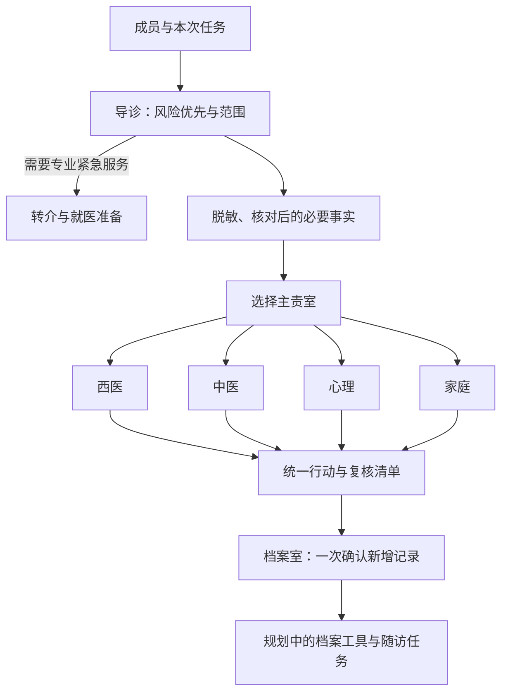

# 架构与职责

一个项目级主 Skill，六个按需加载科室，共享安全、人群、来源及档案规则。首版目标覆盖成人、老人、儿童和孕妇；面向受控私人家庭使用，不包括公众在线医疗服务。

任一阶段可优先转介。图描述产品目标，档案工具尚未实现。命理风水由家庭室独立主动入口调用，不参与医学事实快照。

症状流程通常西医主责；报告流程档案负责本地录入核对、西医负责信息解释；慢病/日常流程由西医和家庭分工。按任务加载儿童、孕期及心理/中医参考。

协作共享相同snapshot_revision和最少授权事实。独立资料检索/不同维度解释可并行；身份、脱敏核对、汇总、确认、同一成员写入串行。科室只产生candidate_records，记录服务是唯一写入者。

科室输出契约见 [room-output.schema.json](../contracts/room-output.schema.json)。主工作流见 [共享工作流](../.agents/skills/chinese-family-doctor-clinic/references/workflows.md)。发生分歧列出各来源、依据、局限和待专业复核问题，安全冲突暂停相关干预，不投票确定治疗。
